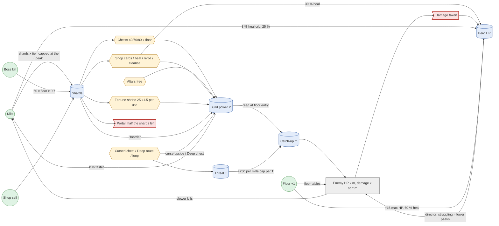

# The economy map (v0.10.5 O16)

Owner P15 ("we can try sure"), P16 ("sure"); built in overnight mode ("Pick and build"). A Machinations-style map
(Adams & Dormans, *Game Mechanics: Advanced Game Design*) of the run's internal economy **as the code stands at
`36382fdd`** (after O2b boss pacing, O4 the director, O5a/O5b loops, O7a the shard taper, O9 rule cards, O10
matchups, S7 more chests). **O7b (shard pickups) is not merged** at that commit (no O7b commit in `git log`), so it
is not on the map. Measurements of the loops are in
[`docs/roadmap/v0.10.5/evidence/O16_ECONOMY.md`](../roadmap/v0.10.5/evidence/O16_ECONOMY.md). Nothing here changes
the game; it is a reading of the code.

Machinations vocabulary used below: a **source** makes a resource, a **pool** holds it, a **converter** turns one
resource into another, a **drain** removes it, a **gate** decides where a flow goes. A **feedback loop** is a chain
that leads back to its own start; **positive** amplifies (the rich get richer), **negative** stabilises. Each loop
is also rated **fast/slow** (how many seconds or floors before it acts) and **strong/weak** (how much it moves the
outcome), as Adams & Dormans rate them.

## The diagram

## The nodes (code and data)

| Node | Type | What it does | Where |
|---|---|---|---|
| Kill shards | Source | A kill pays its kind's shards × (1 + 0.25 × the 30 s danger tier), × 0.7, rounded half up; then the shrine's shard gain, the Shard Gain stat and the A5 Guardian affinity | `src/sim/items/rewards.gd:32` (`shards_for_kill`), `:59` (`_scaled`), `:65` (`on_kill`); `data/rewards/floor.tres` (`shard_tier_bonus = 0.25`, `shard_scale = 0.7`) |
| O7a taper | Gate on the source | The tier a kill pays for stops at the tier of the floor's peak phase start, at least 180 s | `src/sim/items/rewards.gd:43-51`; `data/rewards/floor.tres` (`shard_tier_caps_at_peak`, `shard_cap_min_seconds = 180.0`) |
| Boss shards | Source | 60 × the floor number × 0.7 | `src/sim/items/rewards.gd:33-34`; `src/sim/items/reward_table.gd:45` |
| Shards | Pool | `World.shards`; carried to the next floor | `src/sim/run/run_carry.gd:12` |
| Portal carry | Drain | Only `shard_carry` (0.5) of the unspent shards carry; the rest is `shards_left_behind` | `src/sim/run/run_carry.gd:34-42`; `data/run/five_floors.tres` (`shard_carry = 0.5`) |
| Altars | Converter (free) | 2 a floor (`altars_cap = 2`), 3 cards, pick one | `src/sim/items/rewards.gd:82` (`place`); `data/rewards/floor.tres` |
| Chests | Converter (shards → a card) | 1-2 by room band, + S7's 12 % extras; price 40/60/80 by chest order × (1 + 0.5 × (floor − 1)); one dealt card | `src/sim/items/rewards.gd:82`, `:119` (`_place_extras`), `:306` (`_take` pays); `src/sim/items/reward_table.gd:59` (`chest_price`) |
| Shop | Converter | Every 2nd floor from floor 1: 4 cards at 30/55/90/150 by rarity × the floor step, at most 4 buys; heal 30 % for 40; reroll 20 (+50 % each); cleanse a curse; sell back at 40 % | `src/sim/items/shop.gd:201` (buy), `:229` (heal), `:247` (reroll), `:262` (cleanse), `:303` (sell); `data/shop/terminal.tres` |
| Fortune shrine | Converter | 25 shards on floor 1, × 1.5 each use, 30 % fail, 3 wins max: a stat | `src/sim/items/gamble.gd:308`; `src/sim/items/gamble.gd:10-14` |
| Hoarder | Converter (shards held → damage) | + damage per full 100 shards held; left out of P on purpose | `src/sim/abilities/stats.gd:346` (`hoard_bonus`); `src/sim/world/catch_up.gd:40-41` |
| Build power P | Pool (read, not stored) | weapon level × (damage + Onrush) × Glass Cannon × expected crit × attack rate × (1 + 0.12 per modifier level + 0.08 per plain item + 0.15 per combo) | `src/sim/world/catch_up.gd:36` (`power`); `data/scaling/catch_up.tres` |
| Rule cards (O9) | Converter (cards → conditional power) | Adrenaline, Close Quarters, Third Strike, Scavenger, Reflex, Vent Mend, Heat Shield: **not read by P** | `src/sim/abilities/stats.gd:30-60`; `data/stat_cards/*.tres` |
| Matchups (O10) | Gate on damage | × 1.25 on the enemy's weak form, × 0.75 on its resisted one; **not read by P** | `src/sim/combat/matchups.gd:12` (`hit_mult`); `data/enemies/*.tres` (`weak_permille`, `resist_permille`) |
| Catch-up m | Pool (fixed per floor) | m = clamp(√(P / E), 1, cap + 0.25 × T + loop cap); enemies' HP × m, damage × √m | `src/sim/world/catch_up.gd:122` (`multiplier`), `:149` (`start_floor`), `:162` (`on_enemy`); `data/scaling/catch_up.tres` (E 1000/2000/4000, cap 1500/2000/2500) |
| Boss m (O2b) | Pool (per boss) | HP × pace × min(P, 3 E) / E (at least × 1), × ±8 %; damage × √m | `src/sim/world/catch_up.gd:177` (`read_boss`), `:202` (`pace_multiplier`), `:210`, `:234`; `data/scaling/catch_up.tres` (`boss_pace_permille` 3090/3770/4450, `boss_pace_cap_permille = 3000`) |
| Floor tables | Source (challenge) | Enemy HP × 0.85/1.38/1.90/2.62/3.61, damage × 0.85/1.18/1.40/1.66/1.96 by floor | `src/sim/run/run_state.gd:260` (`scale_enemies`); `data/run/five_floors.tres` |
| Danger tier and curve | Source (challenge, in floor) | HP and damage by the floor's tier and curve as each enemy arrives | `src/sim/world/spawn_table.gd:86` (`hp_now`), `:92` (`power_now`); `src/sim/world/spawn_director.gd:215` (`scale_arrival`) |
| Director (O4) | Gate on spawning | BUILD → PEAK → PULL BACK → QUIET; a STRUGGLING hero (low HP share, few kills) peaks lower, quiets longer, packs one smaller | `src/sim/world/intensity.gd:45` (`advance`), `:166` (`read_standing`), `:187` (`pack_size`) |
| Hero HP | Pool | Max HP + 15 a floor; 60 % of max healed between floors; floor 1's boss room heals full | `src/sim/run/run_carry.gd:44`, `:76` (`floor_hp_bonus`); `src/sim/run/run_state.gd:333`, `:348`; `data/run/five_floors.tres` |
| Heal orbs | Source (HP) | 3 % of normal kills drop one (+ Lifesprout); 25 % of max HP; 16 on the floor at most | `src/sim/items/heal_orbs.gd:24` (`on_kill`), `:41` (`advance`); `data/rewards/floor.tres` |
| Regen | Source (HP) | 1 % max HP a second after 10 s with no damage dealt or taken | `src/sim/combat/player_regen.gd:1-10`, `:40` |
| Fountain | Source (HP) | 25 % of floors from floor 2: one 40 % heal | `src/sim/world/shrines.gd:26-29`, `:108`; `data/shrines/shrines.tres` |
| Threat T | Pool | Held curses' threat + 1 per Deep floor + 2 per loop past the first | `src/sim/events/curses.gd:80` (`threat`); `src/sim/run/run_state.gd:338`, `:347` |
| Cursed chest | Converter (risk → reward) | A chest may turn cursed: the curse card (its upside) or the one card; T rises only by that choice (D49) | `src/sim/events/curses.gd:217`; `src/sim/items/rewards.gd:245` (`deals`) |
| Loops (O5) | Source (challenge) | Each loop past the first: enemy and boss HP × 3.5, damage × 1.2, T + 2, catch-up caps + 0.5, one remixed rule | `src/sim/run/run_state.gd:210` (`loop_permille`), `:265-266`, `:303-304`; `src/sim/run/loop_rules.gd:30`; `data/run/five_floors.tres` |

## The feedback loops

| # | Loop | Sign | Speed | Strength | Code |
|---|---|---|---|---|---|
| L1 | **Kill → shards → chest → power → kill faster → more shards** | Positive | Fast (within a floor: the next chest is one 40-80 shard purchase away) | Weak to medium: income is capped by the O7a taper and by the fixed chest count (the converter runs out, not the source) | `rewards.gd:32-73`, `:82-150`, `:306` |
| L2 | **Power → catch-up m → enemy HP × m → slower kills** | Negative | Slow (read once at floor entry; no rubber band within a floor) | Weak: √ of the surplus, capped at 1.5 / 2.0 / 2.5 (floors 1-3, and floors 4-5 reuse floor 3's) | `catch_up.gd:122`, `:149`, `:162` |
| L3 | **Power → boss pace HP (O2b)** | Negative | Slow (per boss) | Strong up to 3 E (the fight's length is held), then off: past 3 E the fight shortens in step | `catch_up.gd:202-223` |
| L4 | **Unspent shards → the portal keeps half** | Negative (on hoarding) | Slow (once a floor) | Medium: 50 % of the bank | `run_carry.gd:34-42` |
| L5 | **Shards held → Hoarder damage → kills → shards** | Positive | Fast | Weak (one card, per 100 shards, limited) and outside P, so L2 does not answer it | `stats.gd:346`; `catch_up.gd:40` |
| L6 | **Rising prices**: chest order 40 → 60 → 80, × 1.5 a floor; the shrine × 1.5 a use; reroll + 50 % | Negative | Fast (each purchase) | Medium | `reward_table.gd:59`; `gamble.gd:10`; `shop.gd:169` |
| L7 | **Low HP → director struggling → lower peaks, longer quiets, smaller packs → less damage taken** | Negative | Fast (reads the last ~10 s) | Weak by design (changes when, not how hard: O4) | `intensity.gd:166`, `:187` |
| L8 | **Power → more kills → more heal orbs → HP** | Positive | Fast | Weak (3 % a kill, 25 % heal) | `heal_orbs.gd:24` |
| L9 | **Threat T (a curse, Deep, a loop) → catch-up caps + 0.25 each → m may rise** | Negative (on a strong build only) | Slow (floor entry) | Weak: T raises only the cap; it bites only when √(P/E) is above the base cap | `catch_up.gd:144`, `:156`, `:185` |
| L10 | **A curse's upside / Deep's extra chest → power** | Positive (risk → reward) | Slow | Medium (one card or upside a choice) | `curses.gd:217`; `data/run/five_floors.tres` (`deep_extra_chests = 1`) |
| L11 | **Loops: harder × 3.5 HP, more fragments, a remixed rule** | Static escalation (not a loop: it doesn't read the player) | Slow (5 floors) | Strong | `run_state.gd:210`, `:265`; `rune_fragments.gd:47` |
| L12 | **Rule cards and matchups → real damage, not P** | A gap in L2: the negative loop is blind to them | — | Up to × 1.25 (a weak form) and the rule cards' payoffs | `catch_up.gd:36-68`; `matchups.gd:12`; `stats.gd:30` |

How the three curves are measured, and what the measurements say about these loops (runaway, dead, plateaus,
spikes): [`O16_ECONOMY.md`](../roadmap/v0.10.5/evidence/O16_ECONOMY.md).
