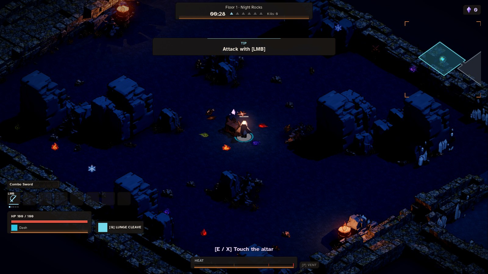
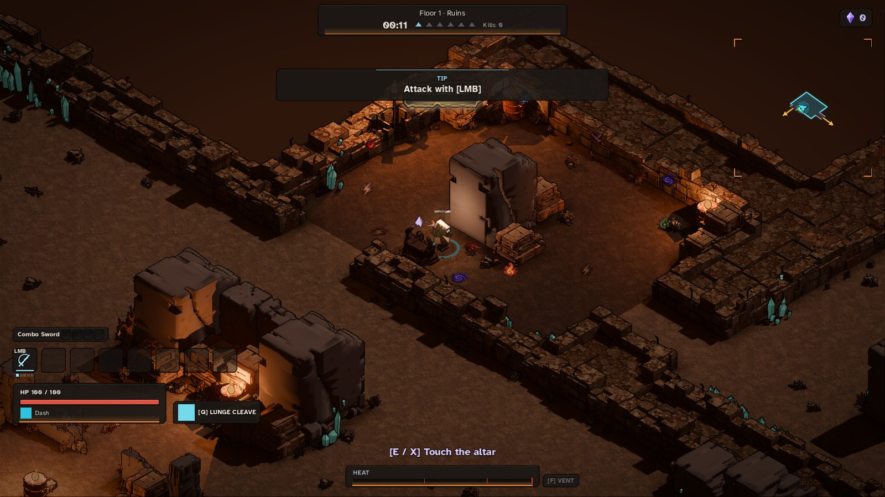
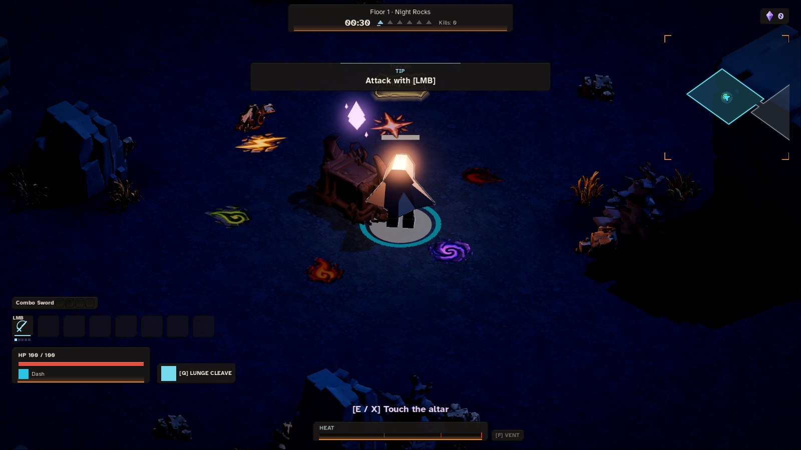
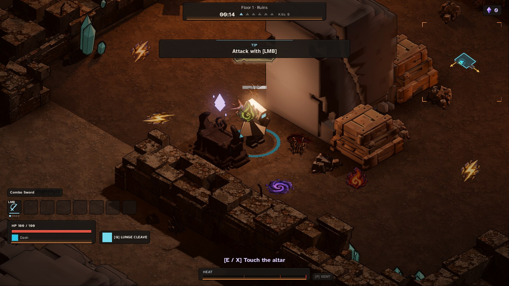
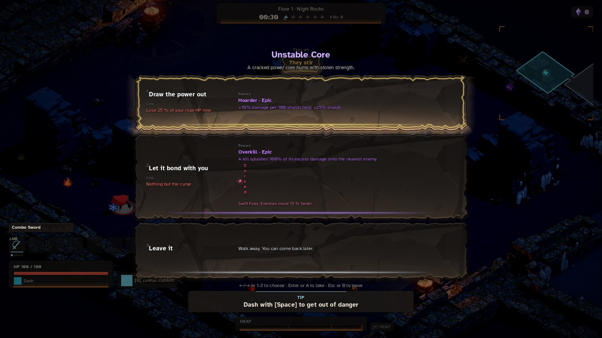
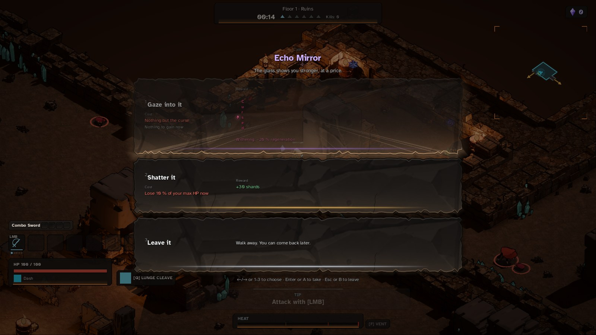

# CURSE_ROOM: curses live in a dark room of their own (v0.8.0 N17)

Owner O75 (verbatim): "what I meant for this is the name displayed on top of the model of the curses device, we need
to create a room for this that looks dark and uses the glyphs symbols around it with a new model, and they need to
appear once max per floor and 40% of floors not all the time, you get to see it when you click it not from the text
over the 3d model". Earlier, O63: cursed chests are to become "a curse room that appears less often". Owner,
2026-10-18, with the model: "here last model for the curse room, give a little light on the floating symbol over the
altar".

Branch `v080-n17` from `b21c313`. Build SHA: the commit that adds this file (see PROGRESS History, 2026-10-18).

## What "the curses device" is (found in the code)

- **The event pedestal** (`src/presentation/world_view/event_pedestal_views.gd`, v0.5.0 EV): a stepped stone base, a
  slanted lectern and a floating violet glyph crystal. Until N17 its name floated above it in a `Label3D`
  (`name_label`, shown within 7 m). Every event uses this one model, the curse pacts too: **Unstable Core**
  ("Let it bond with you": a random curse for an epic stat), **Echo Mirror** ("Gaze into it": a random curse for an
  echo of your best stat), **Whispering Deep** (Deep floors only: a curse for an epic stat). The other six events
  (Ambush Cache, Blood Price, Cleansing Font, Overclock Vent, Scrap Heap, Wandering Drone) offer no curse.
- **Cursed chests are a separate thing** (`Curses.on_offer_rolled`, v0.6.0 CU, kept as a two-card choice by N7/D49):
  a chest whose offer rolled cursed puts a **trade-off** curse card (a drawback *and* an upside, `Pool.TRADE_OFF`)
  before its one card. They roll only on curse floors (1, 3, 5 …), at most one a floor, 25 % per chest offer. No
  `Label3D` names them over the 3D chest (their curse shows on the pick card). Event curses are drawn from the
  **plain** pool (no upside); the trade-off curses come only from cursed chests.

## What changed

1. **No floating name.** The `Label3D` is gone from every pedestal (they are one model, so the owner's "curses
   device" can't be told apart from the others): `EventPedestalViews.label_count()` is 0. The name shows in the event
   panel that E / X opens (`EventPanel.title_text()`). The cue that it can be used stays: the crystal glows and turns.
   The curse altar's HUD prompt says only "[E / X] Touch the altar" / "[E / X] Tocar el altar"
   (`UI_CURSE_ALTAR_OPEN`, appended to `locale/strings.csv`); the other pedestals' prompt still names them
   (`UI_EVENT_OPEN`, unchanged).
2. **The curse room** (`Events.curse_site`): on `curse_room_floor_chance_permille` = 400 of floors
   (`data/event_rules/floor.tres`, a starting value, validated 0..1000), drawn on the named sub-stream
   `map:curse_room` from the floor seed (first draw dropped, like N14's `map:shrine`). The room: an order drawn from
   the same stream over `Gamble.rooms` (combat rooms: not the start hall, the boss room or its host, the portal room,
   the Overrun room, the shop's room, not an arena), minus the shrine's room, the first with a clear pedestal spot
   (`Events.spot`). At most one per floor. The common event rooms are then picked without it. The altar's event is
   drawn on `loot:event` **after** the common rooms' draws, from the curse events only (`EventDefinition.curse_room`:
   Unstable Core and Echo Mirror); the common rooms never draw them. `EventState.curse_k` names the altar.
3. **Saved and hashed**: `curse_k` is in the snapshot (`WorldSnapshot.ADDED_SINCE_V05[&"EventState"]`; an older
   snapshot gets -1) and in the hash once >= 0. **Floor rules 7** (`RunState.FLOOR_RULES`): a floor saved under rules
   1-6 rebuilds its event rooms as before (`FloorScenario.legacy_curse_room_of`: no curse room, every event in the
   common draw).
4. **The look** (`CurseRoomView`, presentation only): a dark shroud over the room's floor (the biome's lighting is not
   touched, as ArenaViews' veil), a cold low light (`#7C86E8`, energy 0.55, no shadow, distance-faded), a ring of 6
   of the owner's glyphs (TX3 sheets, `ElementGlyphs`) carved in the floor round the altar and up to 14 sigils
   floating along the walls, each glowing slowly on its own beat (steady under reduced motion), fading to embers once
   the altar is used. The altar: the owner's `curse_altar` model (below), the code stand-in (dark stone plinth, a
   block with a lip, two horn stones) as the fallback; over it a cracked crystal (two split halves and chips) that
   glows and turns like the pedestals', with its own soft light (below).
5. **The owner's model** (delivered 2026-10-18, `unprocessed_images/models_v080/curse_altar.glb`, a Tripo file: one
   mesh, 58,486 triangles, base colour + metal-roughness + normal maps): `scripts/assets/curse_altar_prep.gd`
   decimates it like `kit_lod.gd` (welded, `ImporterMesh.generate_lods`, each triangle's UV chart kept) and
   downscales its maps to 1024. Listed in `assets/models/manifest.json` (`curse_altar`); `data/credits/licences.tres`
   rebuilt (`scripts/content/build_credits.gd`). In game (`ShopModels` spec `curse_altar`: uniform, 0.98 m high) it
   is 1.40 × 0.98 m on the floor, 0.98 m high, inside the 1.4 × 1.4 × 1.0 m box.
6. **The crystal's light** (owner, 2026-10-18): cold violet `#9C8CFF`, energy 0.8, range 2.4 m, no shadow (never one
   of the 4 shadow casters, BIOME_PERF_AND_LIGHT O30), distance-faded; it pulses ±25 % with the glyphs' beat (steady
   under reduced motion). It replaces the pedestal light the altar would have had: no extra light on the floor.
7. **Cursed chests are kept** (not folded in): owner question **D57** (OWNER_TODO §2).
8. A `curse_altar` row in OWNER_TODO §3.1, ticked delivered (2026-10-18).

## Measured

All numbers below are from the commands shown, on this branch (lint clean), on the session's container.

**Placement odds** (`tests/unit/sim/test_curse_room.gd`, 1,000 floor seeds `1 + s × 7919` with today's map, arena and
shop rules):

```
godot --headless --fixed-fps 60 --path . -s addons/gut/gut_cmdln.gd -gtest=res://tests/unit/presentation/test_curse_room_view.gd,res://tests/unit/presentation/test_event_views.gd,res://tests/unit/sim/test_curse_room.gd -gexit
* test_about_forty_percent_of_floors_get_one_in_an_allowed_room
    curse rooms: 409 of 1000 floors (409 per mille)
* test_the_chance_is_data
    chance 1000: 100 of 100 floors have an allowed room
* test_real_floors_have_at_most_one_altar_and_only_it_holds_a_curse_event
    real floors with a curse room: 4 of 12
```

No floor had a curse room in a forbidden room or more than one curse altar (the asserts in those tests).

**Curse pacts per floor, before and after** (a scratch script, not in the repo:
`godot --headless --path . -s <scratchpad>/fold.gd`; 150 runs × floors 1-3 built by `EventLab.world`, each floor's
events set up again with `legacy = true` for "before"):

```
FOLD| floors 450 | before N17: floors with a curse event 207, curse events 223 | N17: curse rooms 173, floors with a curse event 173, curse events 173
```

So floors offering a curse pact go from 46 % to 38 %, curse pacts from 0.50 to 0.38 a floor. Cursed chests (the
trade-off curses) are unchanged.

**The default e2e floor** (`Main.STAGE_SEED`, floor 1) has no curse room, but its one event room's event changed
(Blood Price → Ambush Cache, the same room 12): the common draw's weights no longer hold the curse events. Its
walls, spawns, rewards and shrine are unchanged. Raw (scratch `find2.gd`, `SaveLab.build_floor`, legacy = floor rules
6):

```
seed 20261006 legacy true curse_k -1 [[&"blood_price", 12]] hash 383005e18b
seed 20261006 legacy false curse_k -1 [[&"ambush_cache", 12]] hash e728bfb574
seed 1 legacy true curse_k -1 [[&"wandering_drone", 2]] hash 79e2a24f34
seed 1 legacy false curse_k 1 [[&"scrap_heap", 16], [&"unstable_core", 14]] hash 9f5dbf9479
```

**The model** (`godot --headless --path . -s scripts/assets/curse_altar_prep.gd -- unprocessed_images/models_v080/curse_altar.glb assets/models/shop/curse_altar.glb`):

```
curse_altar: 58486 -> 1822 triangles  size (99.82143, 69.82849, 69.44391)  maps ["albedo_texture 1024x1024", "roughness_texture 1024x1024", "metallic_texture 1024x1024", "normal_texture 1024x1024"]  ee5add38a97caeab3d8c1a0e8e9a0e04982b89abf27a21f8fc867b8ddfe868ae  assets/models/shop/curse_altar.glb
```

## Tests

The list and totals are in PROGRESS History (2026-10-18, N17). One failure, not N17's: `test_e2e_achievements`
(`its toast shows`, line 79) fails the same on clean `b21c313`:

```
godot --headless --fixed-fps 60 --path . -s addons/gut/gut_cmdln.gd -gtest=res://tests/e2e/test_e2e_achievements.gd -gexit
    [Failed]:  its toast shows
      at line 79
```

## Shots

Commands (Xvfb + llvmpipe, a fresh `XDG_DATA_HOME` for each run; seed 1 is Night Rocks, seed 7 Ruins on floor 1):

```
XDG_DATA_HOME=<empty dir> xvfb-run -a -s "-screen 0 1600x900x24" godot --path . --audio-driver Dummy --resolution 1600x900 -s scripts/shots/curse_room.gd -- seed=1
curse_room: renderer=forward_plus device=llvmpipe (LLVM 20.1.2, 256 bits) window=(1600, 900) seed=1
curse_room: biome=night_rocks altar=(-71.385, 20.175) event=unstable_core room=14
curse_room: res://build/shots/v0.8.0/n17/1_room.png (frame 1305, tick 1804)
curse_room: res://build/shots/v0.8.0/n17/1_close.png (frame 1345, tick 1964)
curse_room: open=1 labels=0 prompt_ok=true
curse_room: res://build/shots/v0.8.0/n17/1_panel.png (frame 1385, tick 2124)
XDG_DATA_HOME=<empty dir> xvfb-run -a -s "-screen 0 1600x900x24" godot --path . --audio-driver Dummy --resolution 1600x900 -s scripts/shots/curse_room.gd -- seed=7
curse_room: renderer=forward_plus device=llvmpipe (LLVM 20.1.2, 256 bits) window=(1600, 900) seed=7
curse_room: biome=ruins altar=(21.1, 31.535) event=echo_mirror room=6
curse_room: res://build/shots/v0.8.0/n17/7_room.png (frame 1310, tick 816)
curse_room: res://build/shots/v0.8.0/n17/7_close.png (frame 1350, tick 976)
curse_room: open=2 labels=0 prompt_ok=true
curse_room: res://build/shots/v0.8.0/n17/7_panel.png (frame 1390, tick 1136)
```

(SHOT HELPER, labelled in the script: the hero's HP is held at max, and the hero is set beside the altar once landed;
reaching it by input is `test_e2e_curse_room`'s job. A first seed-7 run continued seed 1's saved run because the
data folder was shared, and a second was killed by the container's memory; the third, above, is the one used.)
Copied by hand to JPEG in [`n17_shots/`](n17_shots/):

| | Night Rocks (seed 1, Unstable Core) | Ruins (seed 7, Echo Mirror) |
|---|---|---|
| The room |  |  |
| The altar close up (the owner's model, the crystal and its light) |  |  |
| The panel open (the name only here) |  |  |

What the shots show (the agent's reading; the owner judges the look):
- No text over the altar in any shot; the prompt says "[E / X] Touch the altar"; the panel names the pact.
- Night Rocks: the room reads dark, the glyph ring and the wall sigils are visible. **Ruins: the shroud darkens the
  floor only a little against the warm biome light**, and in this small room the altar stands beside a designed-room
  block. Not retuned (a starting value).
- Not N17's, seen in the panel: the "Cursed" mark on a curse choice wraps one letter a line (both shots), and an
  intensity line ("They stir" / "Calm") shows behind the panel's title. Left as they are.
- Ruins' Echo Mirror on floor 1: its curse choice is greyed "Nothing to gain now" (no stat raised yet; the event's
  rule from v0.5.0, unchanged), so that altar offers only its other choice. In D57.

## Owner only

- Does the room read as dark and the glyphs as yours? Is the light on the crystal enough? — OWNER ONLY
- Feel of 40 % of floors — OWNER ONLY
