# CURSE_ROOM_2: the curse room is a dark pact room of its own in every biome (v0.8.0 N19)

Owner O80 (verbatim answers to D57): "1. Is it OK that no pedestal has a floating name now? Yes"; "2. Do 40 % of
floors and these two curse events feel right? yes"; "3. Should Whispering Deep move into the curse room? yes"; "4. Keep
cursed chests as they are? … Yes"; "5. On a fresh run, Echo Mirror greys out its curse option until you've raised a
stat. What should it do instead? not appear until you raised a stat"; "6. Should the Ruins curse room be darker? The
curse room should be a fixed unique small room in every biome like the store, you misstok the right glyphs I meant the
purple ones that some enemies use and we have 4 of those that look kind like a ritual, not the fire, ice etc, the room
should have crystals and ambiented like a dark pact room that's dark and mystical".

Branch `v080-n19` from `b72fd69`. Build SHA: the commit that adds this file (see PROGRESS History, 2026-10-18).
Follows [CURSE_ROOM](CURSE_ROOM.md) (N17).

## How the shop's room works (what N19 copies)

The shop picks a side room in a pass of its own (`ShopPlacement.pick`, its own `shop_room` stream, dead ends first),
then `ShopRoom.furnish` replaces that room's interior with the biome's tent stall: the room's interior pieces leave
`FloorLayout.walls`, the stall's footprints become world walls the dresser never draws (`shop_solids`, added after the
layout's walls, `WorldReader.wall_class` 2), `room_layout[room]` names the shop layout, and the room's spawn points are
cut. N19 does the same for the curse room, but one fixed layout for every biome (the owner: "fixed unique … like the
store"). It reuses a generated room (as the shop does) rather than adding a room to the floor graph, so the doors,
the connectivity and every other room of the floor stay as generated.

## What changed

1. **A room type of its own** (`src/sim/map/curse_room.gd`, `CurseRoom.furnish`, called from `Events.place`): the
   room's interior pieces and designed props go, `room_layout[room]` = `curse_room`, the curse altar stands at its
   spot with its footprint a wall (`ALTAR_HALF_M` 0.55: solid, you walk up to it), crystal clusters stand on up to 10
   spots round the walls (the corners, the sides' middles, two more; footprint half 0.45 m, each solid), each kept
   only when it leaves every doorway's box clear, keeps the item clearance, stays 2.6 m from the altar and the room
   stays one region holding every doorway approach, every item spot and the altar's walk-up (`FloorReach.whole`, as
   ShopRoom). Every spawn point in the room goes (the layout's and the world's): no enemy spawns inside. The world's
   walls are rebuilt as the layout's, then the gate / Deep gate / shrine / shop solids, then the curse solids.
2. **Which room** (`Events.curse_site`): the same draws as N17 on `map:curse_room` (the chance, then the order of
   `Events.curse_rooms`), then grouped keeping the drawn order: small rooms (interior <= 170 m², a one-cell room)
   holding no reward, other rooms holding none, small rooms holding one, the rest; never the shrine's room or the
   shop's room (`layout.shop_room`: see "A fix" below). The altar's spot (`Events.curse_spot`): the room's centre,
   else its spawn points nearest the centre, the first 1.3 m in from the walls and 3 m from every item spot.
3. **Every Deep floor** (`data/event_rules/floor.tres` `curse_room_deep_chance_permille` = 1000, validated 0..1000;
   normal floors keep `curse_room_floor_chance_permille` 400). **Whispering Deep** is a curse event
   (`data/events/whispering_deep.tres` `curse_room = true`): drawn only for the altar, and on a Deep floor first (the
   S5 rule `draw_event` already had), so S5's "a Deep-only event on every Deep floor" holds at the altar.
   **Rule change (documented in GAME_BLUEPRINT, the curse room and "Deep floors bite", and SIM_CONTRACTS §5):** on a Deep floor the altar always holds
   Whispering Deep, so Unstable Core and Echo Mirror appear only on normal floors (D59 (3)).
4. **Echo Mirror** (`data/events/echo_mirror.tres` `requires = &"stat_raised"`, new `EventDefinition.REQUIRES` entry,
   `Events.Need.STAT_RAISED`): drawn only when `Events.strongest_stat` finds a raised stat that can still rise, the
   condition that greyed its curse choice. Checked when the floor's events are set up (D59 (4)).
5. **The look** (`CurseRoomView`, presentation only): the veil darker (alpha 0.78, was 0.62), the cold light lower
   (`#6E78E0`, 0.45, no shadow), the **four purple ritual sigils of `fx_cast_sigils`** (`FxTextures.sigil_material`,
   the sheet the Arc Caster's rune and The Fallen's cast disc use): cell 0 as one 3.6 m sigil under the altar, cells
   1-3 in a ring of three (2.25 m out, 1.25 m), and the four upright on the walls (up to 8, kept 1.6 m from doorways);
   each glows slowly on its own beat and turns slowly (reduced motion: steady, no turn); embers once used. **The
   element glyphs (`ElementGlyphs`, `ui_element_glyphs*`) are no longer used.** Crystals: a code-made cluster of 4-6
   pointed five-sided crystals on each crystal footprint (dark violet `#1C0B2B` with a violet edge glow; every other
   cluster carries glowing points in violet `#B36BFF` or, every fourth, deep red `#E0365A`, pulsing with the sigils).
   The owner's `star_crystal` / ice pieces are the Starfall / Frozen Shore looks' own, so one code palette is used in
   every biome (D59 (1)). The altar's model and its crystal's soft pulsing light are N17's, unchanged.
   The veil and the sigils are drawn **out of the biome's fog** (`disable_fog`; the sigils use FxTextures.SIGIL with
   `fog_disabled`, `CurseRoomView.no_fog_sigil`): the first Frozen Shore shot showed the fog washing the veil out to
   the fog's pale colour (the room no darker than the snow round it) and the additive sigil quads tinted into pale
   squares. The enemies' own sigils keep the shared shader.
6. **The room dresser** (`StageView._dress`, a two-line hook, not in `stage_dresser.gd`): `CurseRoomView.strip` drops
   the dresser's loose decoration (grass, rubble) and wall lights (fire barrels, brazier poles) inside the furnished
   curse room; walls, doorways and every other room are untouched. The crystal-shard dressing already skips rooms
   holding an event.
7. **Panel bugs from N17's shots**: the "Cursed" mark (and the choice key) never wrap (`AUTOWRAP_OFF`: it had no width
   of its own in its row, so it wrapped one letter a line); the phase line ("Calm" / "They stir", `PhaseHud`) hides
   while an event panel is open (it showed behind the panel's title).
8. **Saves**: floor rules 8 (`RunState.FLOOR_RULES`). `FloorScenario.curse_room_rules_of`: rules 1-6 → before N17 (no
   curse room), 7 → N17's (`Events.curse_site_n17`, N17's spot, the room keeps its interior and spawns, Whispering
   Deep in the common draw, Echo Mirror on `stat_card`; `CURSE_RULES_N17`), 8 → today's. `EventCompiler.setup` and
   `Events.setup` / `place` / `draw_event` / `needs_met` take that value (was N17's `legacy` bool).

### A fix found while measuring

`Events.curse_rooms` (`Gamble.rooms` → `ArenaRooms.candidates`) leaves out `Routes.shop_room_of`, a fresh
`ShopPlacement.pick`. Called after the shop room is furnished (as `Events.place` is) that guess can name another room.
With the new small-rooms-first order, run seed 630 floor 1 put the curse room in the shop's furnished room (room 17,
the measuring script's `BAD` line below). `curse_site` now also leaves out `layout.shop_room` itself
(`test_never_the_furnished_shop_room`). N17's own pick on that floor is room 2 (not the shop's), and floors built
under rules 7 keep N17's pick unchanged.

## Measured

All from the commands shown, on this branch, on the session's container (4 cores, other agents' jobs running).

**Room odds** (`tests/unit/sim/test_curse_room.gd`; layouts built like the floor pipeline, 1,000 seeds
`1 + s × 7919` for normal floors, 300 seeds `3 + s × 6007` as Deep floors; rewards not counted in these layout
tests):

```
godot --headless --fixed-fps 60 --path . -s addons/gut/gut_cmdln.gd -gtest=res://tests/unit/sim/test_curse_room.gd,res://tests/unit/sim/test_deep_bite.gd,res://tests/unit/sim/test_events.gd,res://tests/unit/sim/test_event_rooms.gd -gexit
    curse rooms: 409 of 1000 floors (409 per mille)
    in a small room: 405 (of 405 floors with a small room allowed)
    Deep floors with a curse room: 300 of 300
    a reward in the first choice moved the curse room on 79 floors
    chance 1000: 100 of 100 floors have an allowed room
    real floors with a curse room: 4 of 12, altar centred 3, crystals 31
    N17's rules: curse room 2, shop room 17 (kept as saved)
    Echo Mirror drawn 93 of 200 times once a stat is raised
Tests                36
Passing Tests        36
```

No floor had a curse room in a forbidden room (asserts in those tests). Echo Mirror: 0 of 200 curse draws before a
stat is raised (asserted), 93 of 200 after.

**Real floors** (a scratch script, not in the repo: `N=40 godot --headless --path . -s <scratchpad>/measure2.gd`;
`SaveLab.build_floor` as Main, run seeds `500 + s × 13`, floors 1-3, and 40 Deep floors, run seeds `900 + s × 17`,
floors 2-3). Before the shop-room fix:

```
BAD seed 630 f 1 room 17 curse_room 17 spawns_in 0 start 0 boss 19 host 16 portal 19 overrun 12 shop 17 arena false
MEASURE normal 120 with 45 small 44 centred 35 reward_in 0 crystals 310 bad 1 | deep 40 with 40 whispering 40
```

After it:

```
MEASURE normal 120 with 45 small 44 centred 34 reward_in 0 crystals 307 bad 0 | deep 40 with 40 whispering 40
```

So on real floors: 45 of 120 normal floors (375 ‰; the 1,000-seed layout figure is 409 ‰) have a curse room, 44 of
them a small room, the altar exactly centred in 34 (else at the spawn point nearest the centre, kept 3 m from an item
spot), no altar or chest inside any of them, 6.8 crystal clusters a room on average; every Deep floor has one, holding
Whispering Deep.

**The default e2e floor** (`Main.STAGE_SEED` floor 1): no curse room before or after (scratch `seeds.gd`:
`STAGE curse_k -1`); the e2e list below passes unchanged.

## Tests

The list and totals are in PROGRESS History (2026-10-18, N19).

## Shots

Commands (Xvfb + llvmpipe, a fresh `XDG_DATA_HOME` for each run; run seeds whose floor 1 is each biome with a curse
room, found by scratch `seeds.gd`: 1 Night Rocks, 4 Starfall, 7 Ruins, 11 Red Canyon, 14 Frozen Shore):

```
XDG_DATA_HOME=<empty dir> xvfb-run -a -s "-screen 0 1600x900x24" godot --path . --audio-driver Dummy --resolution 1600x900 -s scripts/shots/curse_room.gd -- seed=<N>
curse_room: renderer=forward_plus device=llvmpipe (LLVM 20.1.2, 256 bits) window=(1600, 900) seed=14
curse_room: biome=frozen_shore altar=(-8.090002, 25.7) event=unstable_core room=7
curse_room: res://build/shots/v0.8.0/n19/14_room.png (frame 964, tick 816)
curse_room: res://build/shots/v0.8.0/n19/14_close.png (frame 1004, tick 976)
curse_room: open=1 labels=0 prompt_ok=true
curse_room: res://build/shots/v0.8.0/n19/14_panel.png (frame 1044, tick 1136)
exit 0
curse_room: renderer=forward_plus device=llvmpipe (LLVM 20.1.2, 256 bits) window=(1600, 900) seed=1
curse_room: biome=night_rocks altar=(0.445, -27.17) event=unstable_core room=17
curse_room: res://build/shots/v0.8.0/n19/1_room.png (frame 1075, tick 816)
curse_room: res://build/shots/v0.8.0/n19/1_close.png (frame 1115, tick 976)
curse_room: open=1 labels=0 prompt_ok=true
curse_room: res://build/shots/v0.8.0/n19/1_panel.png (frame 1155, tick 1136)
exit 0
curse_room: renderer=forward_plus device=llvmpipe (LLVM 20.1.2, 256 bits) window=(1600, 900) seed=4
curse_room: biome=starfall altar=(-46.81001, 0.61) event=unstable_core room=11
curse_room: res://build/shots/v0.8.0/n19/4_room.png (frame 1077, tick 816)
curse_room: res://build/shots/v0.8.0/n19/4_close.png (frame 1117, tick 976)
curse_room: open=1 labels=0 prompt_ok=true
curse_room: res://build/shots/v0.8.0/n19/4_panel.png (frame 1157, tick 1136)
exit 0
curse_room: renderer=forward_plus device=llvmpipe (LLVM 20.1.2, 256 bits) window=(1600, 900) seed=7
curse_room: biome=ruins altar=(22.155, 35.205) event=unstable_core room=6
curse_room: res://build/shots/v0.8.0/n19/7_room.png (frame 1732, tick 816)
curse_room: open=2 labels=0 prompt_ok=true
curse_room: res://build/shots/v0.8.0/n19/7_panel.png (frame 1580, tick 1136)
exit 143
curse_room: renderer=forward_plus device=llvmpipe (LLVM 20.1.2, 256 bits) window=(1600, 900) seed=11
curse_room: biome=red_canyon altar=(-45.175, -1.945) event=unstable_core room=17
curse_room: res://build/shots/v0.8.0/n19/11_room.png (frame 1479, tick 816)
curse_room: res://build/shots/v0.8.0/n19/11_close.png (frame 1519, tick 976)
curse_room: open=1 labels=0 prompt_ok=true
curse_room: res://build/shots/v0.8.0/n19/11_panel.png (frame 1559, tick 1136)
exit 0
```

(SHOT HELPER, labelled in the script: the hero's HP is held at max, and the hero is set at the altar's walk-up once
landed; reaching it by input is `test_e2e_curse_room`'s job.) Copied by hand to JPEG in [`n19_shots/`](n19_shots/):

| Biome (seed) | The room | The altar close up | The panel |
|---|---|---|---|
| Night Rocks (1) | 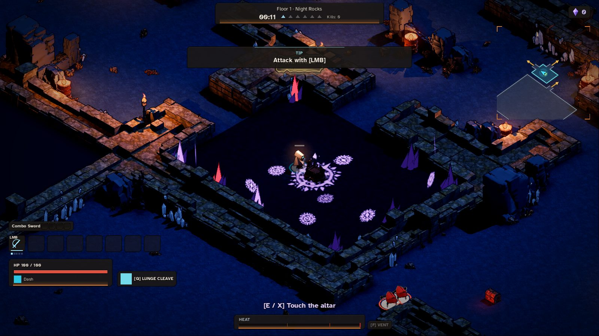 | 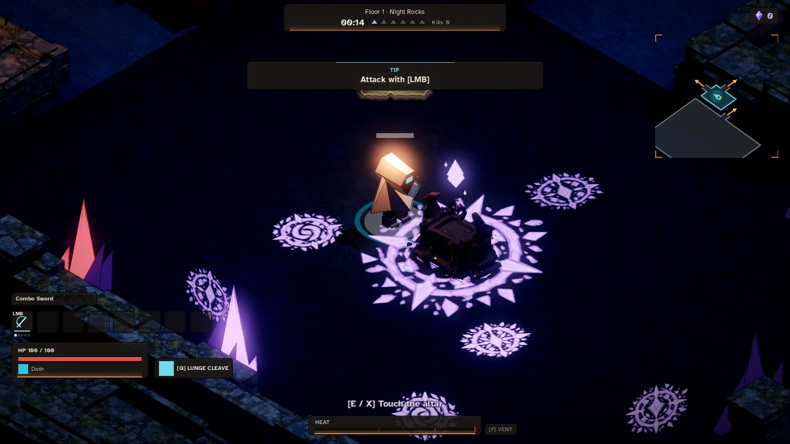 | 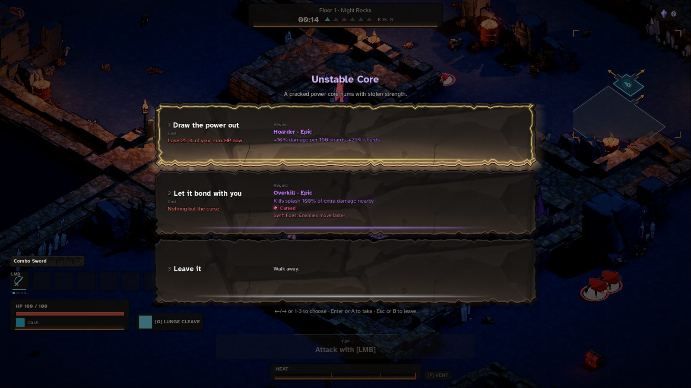 |
| Starfall (4) | 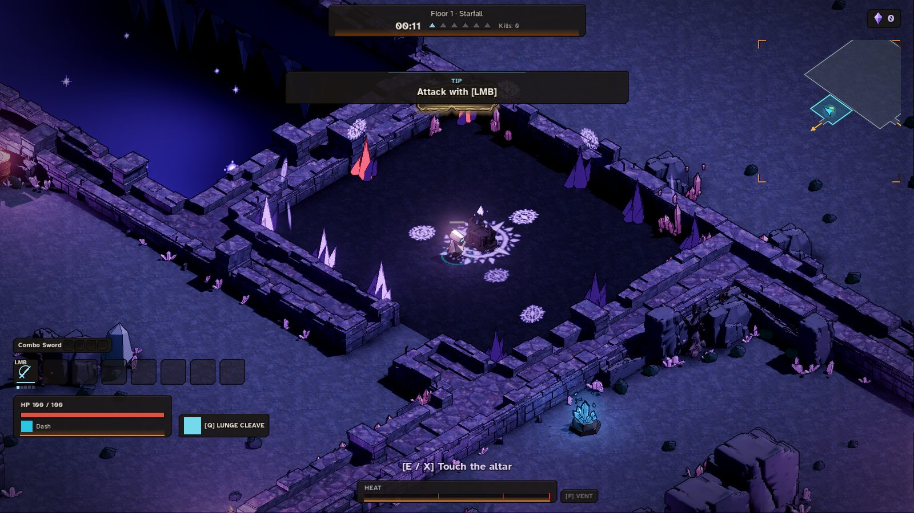 | 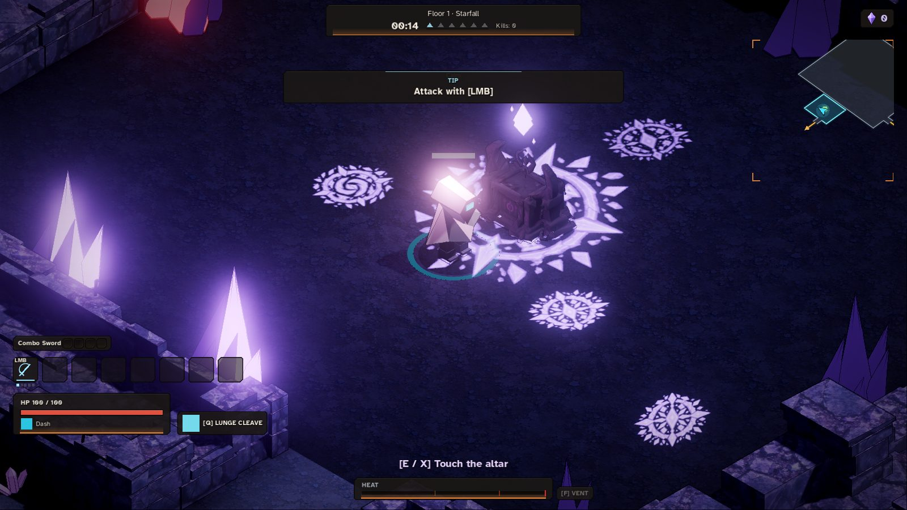 | 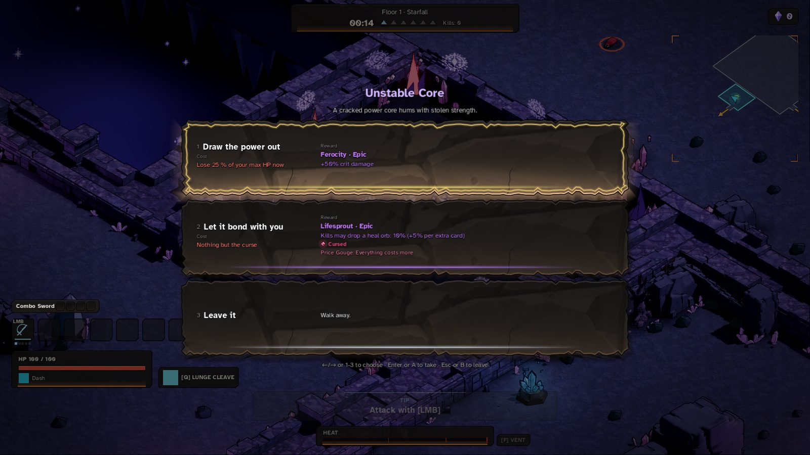 |
| Ruins (7) | 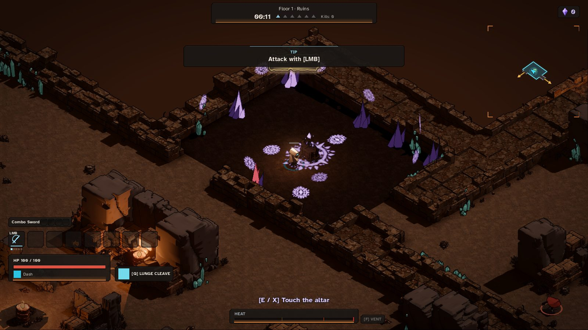 | 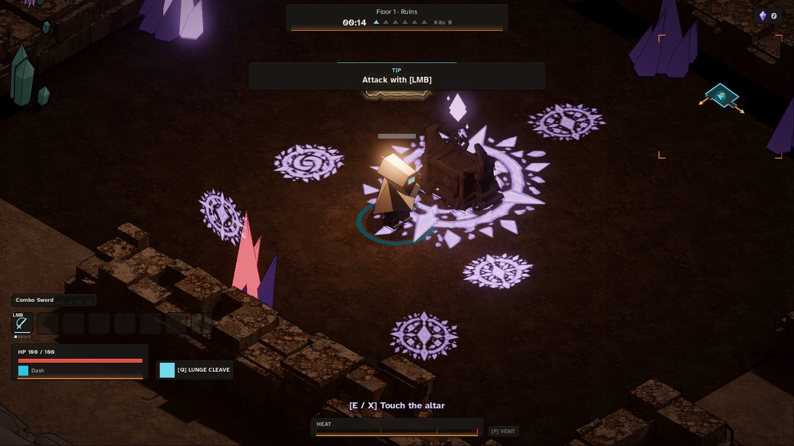 | 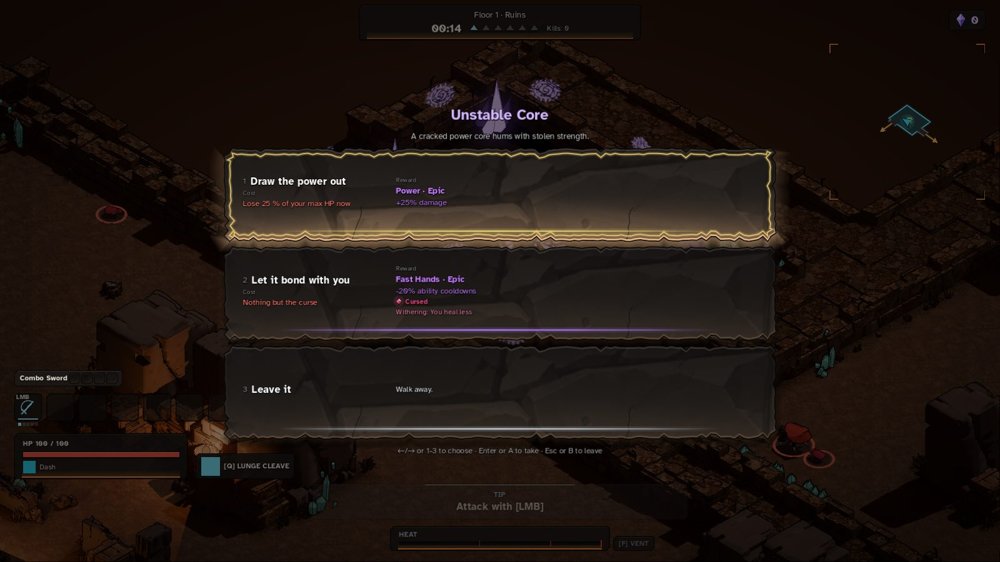 |
| Red Canyon (11) | 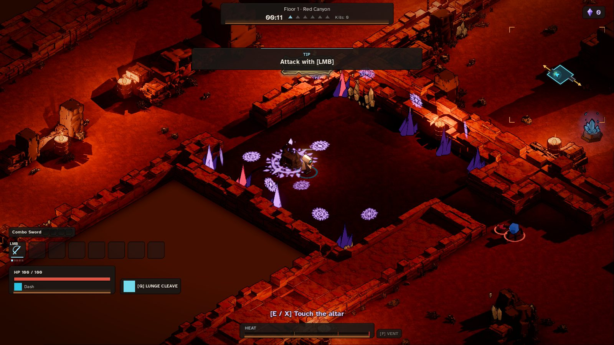 | 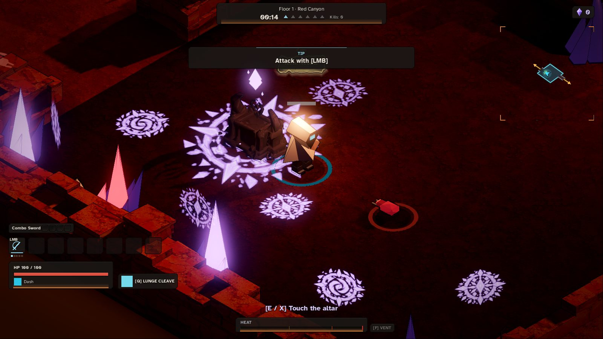 | 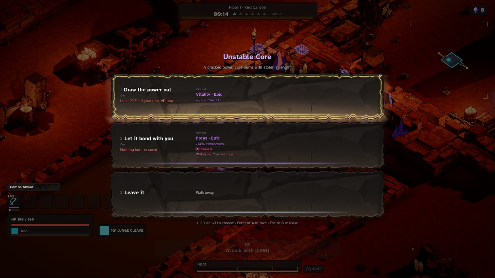 |
| Frozen Shore (14) | 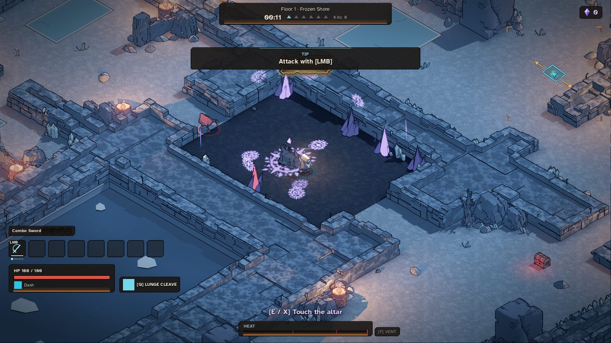 | 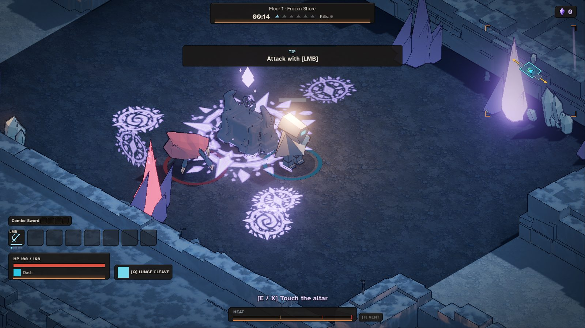 | 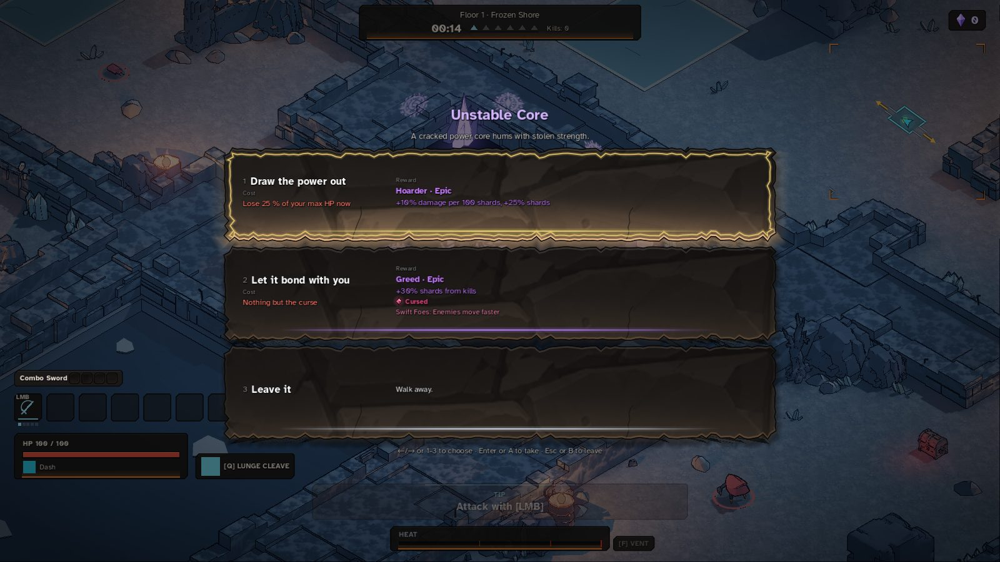 |

What the shots show (the agent's reading; the owner judges the look):
- Every biome: the room reads darker than the rooms round it, the four sigils glow violet (the big one under the altar,
  the ring, the upright ones on the walls), crystal clusters stand round the walls (a few glowing violet or red), no
  rubble or wall braziers inside, no text over the altar; the prompt says "[E / X] Touch the altar". The panel names
  the pact, the "Cursed" mark sits on one line and no phase line shows behind the title.
- Ruins and Red Canyon: the veil darkens the room clearly, but the biome's warm light still tints it. Not retuned (the
  veil alpha 0.78 is a starting value).
- Red Canyon (seed 11): the altar stands at the spawn point nearest the centre, not the centre (the centre is within
  3 m of the room's item spot).
- Frozen Shore: the first run (before the fog fix) showed the room no darker than the snow and the sigils as pale
  squares; the shots here are after it.
- Seed 7: two runs of the same commit and seed wrote the same log and shot files (a stray earlier run was still going;
  I killed it, its `exit 143`). The log above is that mix (the stray run's room line at frame 1732). The run that
  completed printed, in its own task output: `7_room.png (frame 1500, tick 816)`, `7_close.png (frame 1540, tick 976)`,
  `open=2 labels=0 prompt_ok=true`, `7_panel.png (frame 1580, tick 1136)`; `7_room.png` on disk is the stray run's
  (written last, 16:50), the same seed and code. Earlier retries of seeds 7 and 11 were killed (exit 137 / 144) while other
  agents rendered on the container; the runs above are the ones that completed.
- The "TIP Attack with [LMB]" plaque over the top of each room shot is the first-run tip (a fresh profile).

## Owner only

- Does the room read as a dark, mystical pact room? Are these the right sigils, and do the crystals suit it? — OWNER
  ONLY
- Feel of the room's size and of every Deep floor having one — OWNER ONLY
