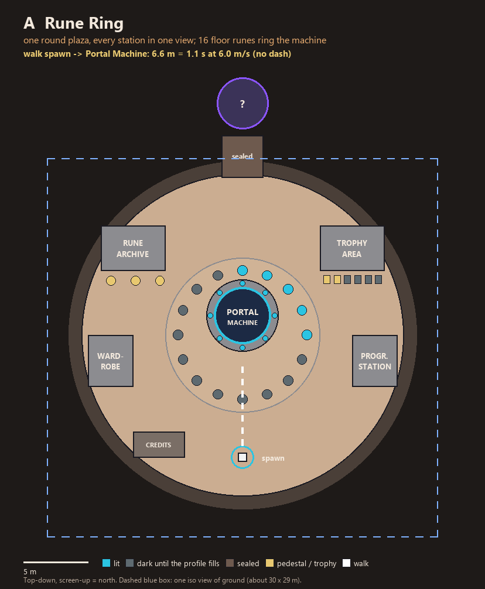
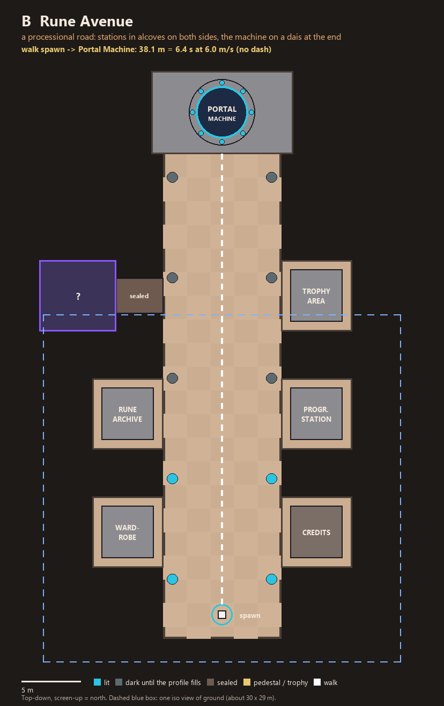
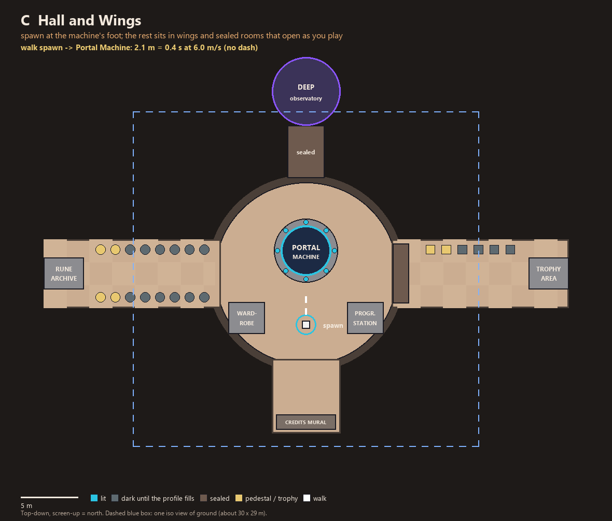

# v0.9.0 HB: the hub (G2, waiting for the owner)

Drafted by the lead's agent while the owner was away (2026-10-23). Answer per option: approve, change: …, drop.
**Nothing is built until approved.**

The owner's decision (PLAN "Owner decisions" Q27, 2026-10-22): *"You will have a small menu, with options, continue
and play, and the rest of the thing go into the hub"*. The menu is Play, Continue, Options and Quit. Everything else
moves into a walkable hub: the **Portal Machine** starts a run; the **Rune Archive** holds the Codex and the
collectibles; the **Wardrobe**; the **Progression Station**; the **Trophy Area**; the **Credits**. The hub changes
with profile flags (W45, W46: some changes get no toast). Death or a win shows the summary, then **Restart** (one
press) or **Hub** (W48).

**What these images are.** Top-down floor plans drawn with Pillow (Ruins palette, ART_DIRECTION §2), one per option,
so the owner can pick a layout before anything is modelled. They are not the in-engine 1920×1080 en/es mockups of
OWNER_GATES §3: those are made for the picked option with `scripts/shots/mock_hub.gd` once a layout is chosen (that
needs code, which this step does not touch).

## Shared by all three options

- **Menu:** Play (enters the hub; first launch spawns there too), Continue (resumes the saved run; greyed out when
  there is none), Options, Quit. The Codex, Credits and achievements leave the menu.
- **Portal Machine:** walk into its ring and press the interact key (`[E / X]`, like the rune pillar and the boss
  door today); it reuses SA's altar look (blue runes and jewels lighting in sequence, C11, C15) so the hub machine and
  the floor-1 altar read as one network (W42).
- **After a run:** the summary panel, then **Restart** (one press, new seed, straight into a run: the same as today's
  EndPanel Restart, `main.gd:522-546` per the PLAN audit) or **Hub** (spawn at the hub's spawn point).
- **Walk times** use the hero's run speed **6.0 m/s** (`move_speed_mps` default in
  `src/content/defs/player_definition.gd:11`; `data/player/runner.tres` does not override it), straight line from the
  spawn to the edge of the machine's interaction ring, no dash (the dash is 4 m, cooldown 1.4 s, so it only shortens
  B). Acceleration (0.1 s to 90 %) is ignored.
- **The iso view** (`iso_rig.gd`: yaw 45°, pitch 35.26°, ortho size 17 m) shows about 30 × 29 m of ground at 16:9.
  The dashed blue box in each image is that footprint.
- **Profile flags** the evolving states can read: today's profile holds the Codex and the 32 achievements
  (`profile_store.gd` header; `data/achievements/` has 32 files); the collectibles (CL) and Rune Fragment unlocks (MP)
  arrive with profile version 2.

## Option A: Rune Ring

**One round plaza (25 m across), every station in one view, 16 floor runes ringing the machine.**

| | |
|---|---|
| Walk to the machine | **6.6 m = 1.1 s** |
| Layout | The Portal Machine in the centre on a raised ring. Around the rim: Rune Archive (NW), Trophy Area (NE), Wardrobe (W), Progression Station (E), a Credits stone (SW). A sealed gate in the north rim leads to a small secret alcove. |
| How it reads in the iso camera | The whole plaza fits in one view, so the camera barely moves: the player sees every station from the spawn. The machine is the tallest thing and sits dead centre. With yaw 45°, the NW and NE stations sit at the top of the screen (tall props there can't hide the hero); keep the S rim low (no tall props between the camera and the hero). |
| How it evolves | The 16 floor runes light one per collectible found (the ring is the progress bar, no number). The Trophy Area's plinths fill as bosses fall (a symbol per boss in the Codex). The Archive's pedestals show the collected artifacts. The north gate opens after a chosen discovery (proposal: the first Purple Portal), revealing the alcove with a hub collectible (W47). |
| Strengths | Fastest to read; restart via the hub is quick; cheapest. |
| Weaknesses | Little to explore: "a mystery worth exploring" (W5) rests on one alcove and the runes. |
| Cost | **S** (one room, one sealed gate, props on a ring) |
| Models it needs | Portal Machine (reuses SA altar parts, larger), floor rune stone (×16, lit/dark), Archive shelf + pedestal, Trophy plinth + boss symbol plaque, Wardrobe (mannequin/robe stand), Progression Station (rune console), Credits stone, sealed gate (closed/open), alcove pedestal. |

## Option B: Rune Avenue

**A processional road (10 m wide, 43 m long): stations in alcoves on both sides, the machine on a dais at the end.**

| | |
|---|---|
| Walk to the machine | **38.1 m = 6.4 s** (an estimate of about 4.6 s with the dash used on every cooldown, from the dash's ~27 m/s noted in `player_avatar.gd:97`) |
| Layout | Spawn at the south end. Pairs of alcoves: Wardrobe / Credits, Rune Archive / Progression Station, then the Trophy Area (east) facing a sealed side corridor (west) to a secret room. The Portal Machine on a stone dais at the north end. Pylons line the road. |
| How it reads in the iso camera | About a view and a half long: the camera follows the hero up the road, the machine comes into view half-way. Because the road runs screen-up, the alcoves read as side rooms left and right, a clean silhouette. The dais needs height so the machine is visible from the spawn as a goal. |
| How it evolves | The pylons along the road light, one pair per boss beaten (the road "wakes up" toward the machine). The alcoves start dim and light when first used. The sealed side corridor opens after a chosen discovery. Collected artifacts on the Archive's shelves. |
| Strengths | A clear "walk to the portal" ritual; the evolving pylons are easy to notice. |
| Weaknesses | 6.4 s every time you go in through the hub (Restart skips it, but Hub → run doesn't); a straight road is little to explore. |
| Cost | **M** (a long room, five alcoves, a side room) |
| Models it needs | Portal Machine on a dais, road pylon (lit/dark, ×10), alcove frame, Archive shelf + pedestal, Trophy wall + boss plaques, Wardrobe, Progression Station, Credits plaque, sealed corridor door, secret-room pedestal. |

## Option C: Hall and Wings

**A round hall with the spawn at the machine's foot; the Archive and Trophy wings and a deep observatory open as you
play.**

| | |
|---|---|
| Walk to the machine | **2.1 m = 0.4 s** |
| Layout | A central hall (16 m across): the Portal Machine at its centre, the spawn just south of it, the Wardrobe and Progression Station inside the hall. West wing: the Rune Archive gallery, 16 pedestals in two rows. East wing: the Trophy Area behind a sealed arch. South vestibule: the Credits mural. North: a sealed corridor to the Deep Observatory (a secret room, starfield). |
| How it reads in the iso camera | The hall plus the wing mouths fit in one view; the wings run off the screen's sides, so they read as places to go. The Archive gallery's 16 pedestals are a row the eye follows. The north corridor at the top of the screen is in plain sight but sealed, a visible mystery. |
| How it evolves | The Archive's pedestals hold each collectible as it is found (16, W45 "artifacts on pedestals"). The east arch opens after the first boss kill; its plaques fill per boss. The north corridor opens after a chosen discovery (proposal: the Purple Portal), and the observatory's stars light as the Starfall and final-boss flags fill. Small details change on milestones (banners, torches) with no toast (W46). |
| Strengths | Fastest to the run; the most to explore; the evolving states are spread over real places. |
| Weaknesses | The most building; three rooms joined to one hall. |
| Cost | **L** (a hall, two wings, a vestibule, a sealed corridor, a secret room) |
| Models it needs | Portal Machine, gallery pedestal (×16, empty/full), Archive lectern (the Codex), Trophy plaque wall + boss symbols, sealed arch (closed/open), Wardrobe, Progression Station, Credits mural slab, sealed corridor door, observatory dome + star crystals (reuses Starfall's star crystals). |

## Comparison

| | A Rune Ring | B Rune Avenue | C Hall and Wings |
|---|---|---|---|
| Walk to the machine | 1.1 s | 6.4 s | 0.4 s |
| Views to see it all | 1 | ~1.5 | ~2 |
| Exploration (W5, W47) | low | low–medium | high |
| Evolving states (W45) | rune ring, plinths, one gate | pylons, alcoves, one corridor | pedestals, east wing, observatory, details |
| Cost | S | M | L |

**Pick A, B or C (or mix).** A mix example: C's hall and wings with A's 16-rune ring around the machine.

## Decisions (owner, date)

| Option | Answer | Built in |
|---|---|---|
| | | |
